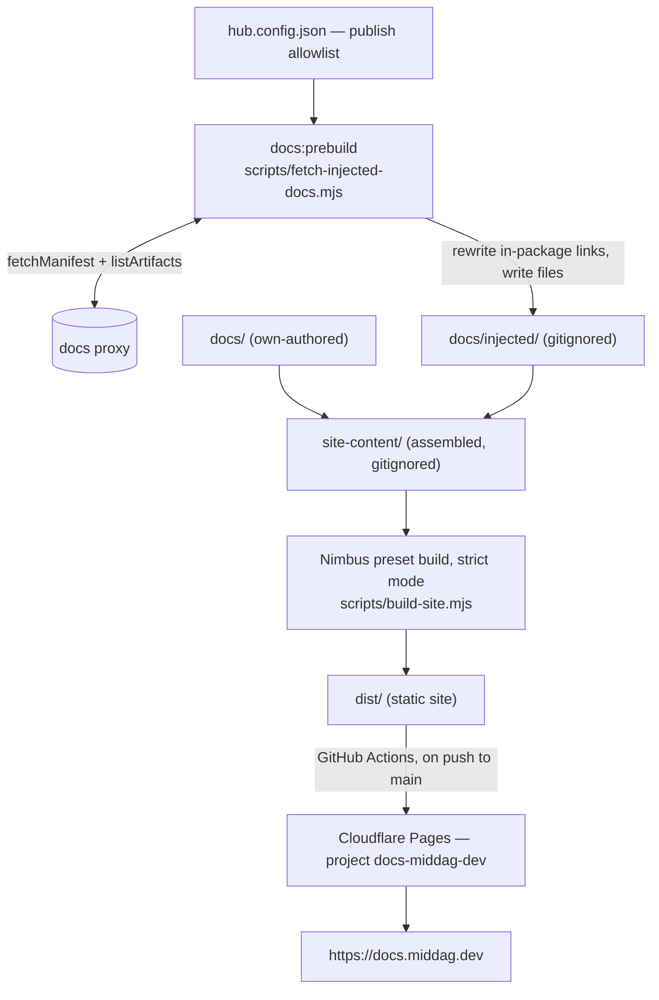

# docs-middag-dev

MIDDAG's developer documentation hub, published at **<https://docs.middag.dev>**.
It is a static site built with the Nimbus preset (`@middag-io/nimbus-preset`)
and deployed to Cloudflare Pages.

The hub has **two content layers**:

- **Own-authored (versionless).** The documentation of the open-source MIDDAG
  PHP libraries (the MIDDAG Framework, its host adapters, `middag-php-ui` and
  the example application `middag-php-demo-standalone`) and the policy of the
  library family are written here, in `docs/<axis>/`, following Diataxis.
- **Aggregated (versioned).** A library that keeps its own documentation site
  (for example `middag-react`) publishes a versioned documentation payload to
  the MIDDAG docs proxy. At build time the hub pulls the channels it declares
  and serves each one under `/{repo}/{segment}/`.

## Architecture



### How it works

1. **Allowlist.** `hub.config.json` lists which libraries the hub aggregates
   and, per library, which **channels** (versions) are published. Nothing
   aggregated appears on the site unless it is declared here.
2. **Fetch and inject** (`scripts/fetch-injected-docs.mjs`, run as
   `docs:prebuild`):
   - resolves each declared channel selector against the versions the proxy
     retains: `latest` is the newest, `0.30.x` the highest retained `0.30.*`,
     or an exact pin;
   - downloads every file into `docs/injected/{repo}/{segment}/`, one folder
     per channel (`latest` stays `latest`; `0.30.x` becomes `0.30`);
   - rewrites root-absolute in-package links (`](/x)`, `href="/x"`, home
     `link:` fields) to `/{repo}/{segment}/x`; external, anchor and relative
     links are left untouched;
   - writes `docs/injected/{repo}/_channels.json` (label and resolved
     channels), which the build turns into navigation.
3. **Build** (`scripts/build-site.mjs`, run as `docs:build`):
   1. runs `docs:prebuild` (skipped with `docs:build:nofetch`);
   2. copies `docs/` and `docs/injected/{repo}/{segment}/` into `site-content/`,
      mounted at the site root by [`middag-docs.config.ts`](middag-docs.config.ts),
      so every page keeps its URL;
   3. runs the publish guard over the assembled tree: it refuses
      `decisions/`, `internal/`, `adr/` and `madr/` paths;
   4. writes landing pages where a directory has none (`/{repo}/`,
      `/libraries/reference/`), marks older channels `searchable: false`,
      keeps the dots of channel URLs (`/middag-react/0.30/`) and turns `{#id}`
      heading ids into anchors;
   5. turns each axis's `nav.json` and the channel manifests into navigation
      order and labels (`site-navigation.json`, gitignored);
   6. builds into `dist/` in strict mode: any preset warning fails the build;
   7. adds an empty anchor with the previous heading id before every heading
      whose id changed, so deep links from outside keep working, and checks
      `dist/`: home built from `docs/index.md`, no `/index/` route, search
      index present, `_redirects` (copied from `site-public/`) sends
      `/sitemap.xml` to `/sitemap-index.xml`, every internal link and anchor
      resolves, and every URL of the sitemap snapshot
      (`test/fixtures/live-sitemap-urls.txt`) has a page or a redirect.
4. **Deploy.** GitHub Actions builds `dist/` and deploys it to Cloudflare Pages
   on every push to `main` ([Deployment](#deployment)).

## Project layout

```
docs-middag-dev/
├─ .github/workflows/
│  ├─ pr-checks.yml           # format, tests and the full site build on every pull request
│  └─ deploy.yml              # production deploy to Cloudflare Pages
├─ docs/                      # own-authored content (see below); docs/injected/ is generated
├─ scripts/
│  ├─ build-site.mjs          # assemble, guard, build with the Nimbus preset, check dist/
│  ├─ fetch-injected-docs.mjs # build-time injector of the aggregated channels
│  └─ lib/                    # publish guard and site build helpers
├─ site-public/               # files copied as is into dist/ (_redirects)
├─ test/                      # node:test suites and fixtures
├─ hub.config.json            # publish allowlist: repos, labels and channels
├─ middag-docs.config.ts      # Nimbus site configuration
├─ .npmrc                     # maps the @middag-io scope to GitHub Packages
└─ package.json
```

## Own-authored content tree

The own-authored layer is split by **product axis first**, then by Diataxis
type. Each axis is a full Diataxis documentation, so the adapter or concern is
a subfolder under each Diataxis type: one `adapters/moodle/` per type instead
of four empty copies per concern.

```
docs/
├── framework/          # MIDDAG Framework (OSS) + middag-php-ui
│   ├── tutorials/      # each type: adapters/{moodle,wordpress,standalone}/ and ui/
│   ├── how-to/
│   ├── reference/
│   └── explanation/
└── libraries/          # policy of the PHP libraries
    └── reference/
```

- **`framework/`**: `middag-php-framework`, its host adapters (`moodle`,
  `wordpress`, `standalone`), `middag-php-ui` and the example application
  `middag-php-demo-standalone` (`reference/demo-standalone/`). The source
  repositories keep their `README.md`, `API-STABILITY.md` and decision records;
  the guides and the reference live here.
- **`libraries/`**: versioning and compatibility, platform, documentation
  publication and guards. It sits outside `framework/` because it also states
  where the documentation of the internal libraries lives. Reference only; it
  documents no library API.
- **`ui/`** is a leaf under the Diataxis folders of `framework/`, not a third
  axis. On the site it gets its own sidebar entry, because `middag-php-ui` is an
  isolated library rather than a host adapter. Navigation
  (`docs/<axis>/nav.json`) and the physical path are decoupled on purpose.
- **Not in this tree**: libraries with their own documentation site (for
  example `middag-react`) stay on the aggregated layer.
- **Decision records are never in this tree.** Every library keeps them in its
  own `docs/decisions/`.

## Local development

**Prerequisites**

- Node.js 24 (CI runs Node 24).
- Read access to the `@middag-io` packages on GitHub Packages. The committed
  `.npmrc` reads the token from `NODE_AUTH_TOKEN`:
  ```bash
  export NODE_AUTH_TOKEN=<GitHub PAT with read:packages>
  ```

**Run**

```bash
npm ci
npm run docs:build      # prebuild (fetch docs) + full site build into dist/
npm run docs:preview    # serve dist/ locally
```

The `docs:prebuild` step reaches the **public** docs proxy anonymously and
fails if `DOCS_PROXY_TOKEN` is set: this hub is never built from the private
deployment.

## Scripts

| Script               | What it does                                                                          |
| -------------------- | ------------------------------------------------------------------------------------- |
| `docs:prebuild`      | Fetch and inject the declared channels from the proxy into `docs/injected/`           |
| `docs:build`         | Full site build (`scripts/build-site.mjs`): prebuild, assemble, Nimbus build, checks  |
| `docs:build:nofetch` | `docs:build` against the already-injected tree (skips the proxy fetch)                |
| `docs:preview`       | Serve the built `dist/` locally                                                       |
| `docs:available`     | Read-only discovery: list repos and versions in the proxy and diff against the allowlist |
| `site:build`, `site:build:nofetch`, `site:preview` | Aliases of `docs:build`, `docs:build:nofetch` and `docs:preview` |
| `test`               | Unit tests and the end-to-end build checks (`node --test`)                            |
| `format`, `format:check` | Prettier                                                                          |

## Publishing a library version to the hub

`hub.config.json` is the allowlist. Declare the repo, a friendly `label`, and
the `channels` to publish (order is display order; the first is the default):

```json
{
  "repos": {
    "middag-react": { "label": "MIDDAG React", "channels": ["latest", "0.30.x", "0.20.x"] },
    "another-lib": { "label": "Another Lib", "channels": ["latest"] }
  }
}
```

`kinds` (optional, default `["docs"]`) names the artifact kinds pulled for
the repo: `docs` (Markdown pages) and `xref` (generated API reference HTML).
Any other kind fails the build. An `xref` channel is staged byte for byte in
`.xref/{repo}/{segment}/` (gitignored), copied after the site build to
`dist/api/{repo}/{segment}/` without any rewrite, and linked from an "API
reference" page in the docs channel (or from the repo landing for an
xref-only repo, e.g. `"kinds": ["xref"]`). The link check skips `dist/api/**`;
a light check requires each copied tree to have an HTML `index.html`.

The prebuild uses `fetchHub` and `assertPublicTarget` from
`@middag-io/docs-proxy-client`: this public hub refuses to run when
`DOCS_PROXY_TOKEN` is set or the proxy is not `https://docs-proxy.middag.dev`.

Channel selectors: `latest` (the newest version in the proxy manifest),
`MAJOR.MINOR.x` (highest retained patch of that line), or an exact `X.Y.Z` pin.
Each becomes a versioned URL `/{repo}/{segment}/` with its own navigation. The
library must publish a `docs` payload to the proxy from its release workflow.
To unpublish a version, remove its channel here: the allowlist is
default-hidden.

## Deployment

[`.github/workflows/pr-checks.yml`](.github/workflows/pr-checks.yml) runs the
format check, the tests and the full site build on every pull request from this
repository; a pull request that breaks the build, a link or an anchor fails
there.

[`.github/workflows/deploy.yml`](.github/workflows/deploy.yml) runs on push to
`main` (or manual `workflow_dispatch`). A `build` job installs, tests and runs
`site:build`, then uploads `dist/`; a `deploy` job, under the `production`
environment and with no checkout, deploys it to the Cloudflare Pages project
`docs-middag-dev` with `cloudflare/wrangler-action` pinned by commit SHA.

**Required repository configuration**

| Name                    | Type   | Where                     | Purpose                                              |
| ----------------------- | ------ | ------------------------- | ---------------------------------------------------- |
| `CLOUDFLARE_API_TOKEN`  | secret | `production` environment  | Cloudflare token with **Pages: Edit**                |
| `CLOUDFLARE_ACCOUNT_ID` | var    | repository                | Target Cloudflare account                            |
| `NODE_AUTH_TOKEN`       | secret | repository                | *(optional)* PAT with `read:packages`; falls back to `GITHUB_TOKEN` when the `@middag-io` packages grant this repository read access |

The `production` environment accepts deployments from `main` only.

## References

- [Cloudflare Pages](https://developers.cloudflare.com/pages/)
